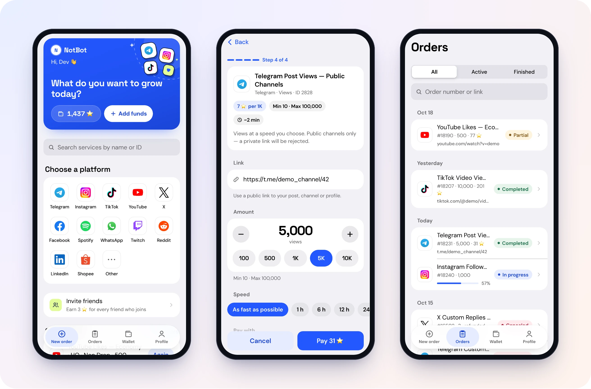
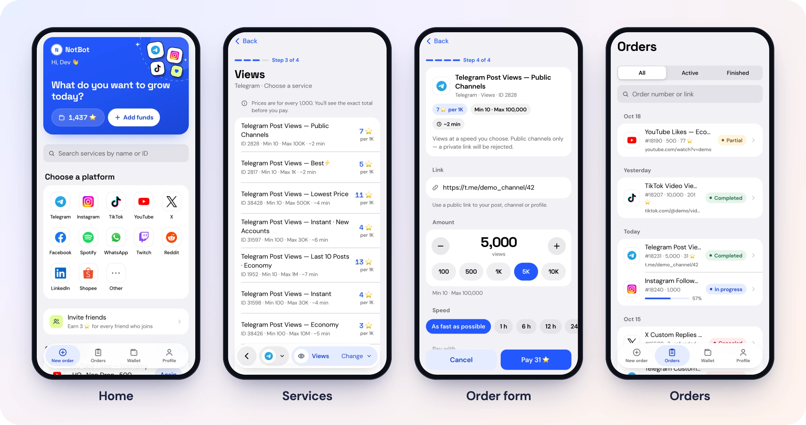
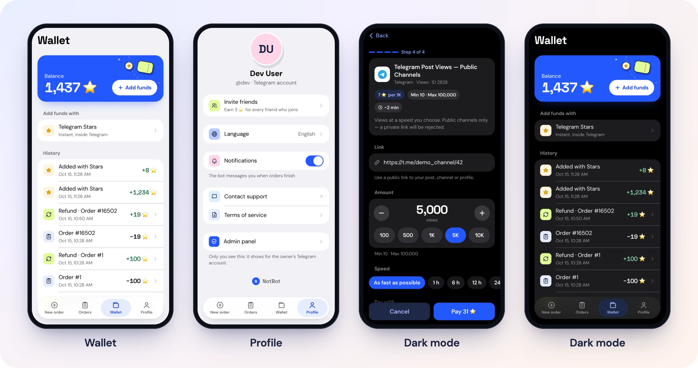
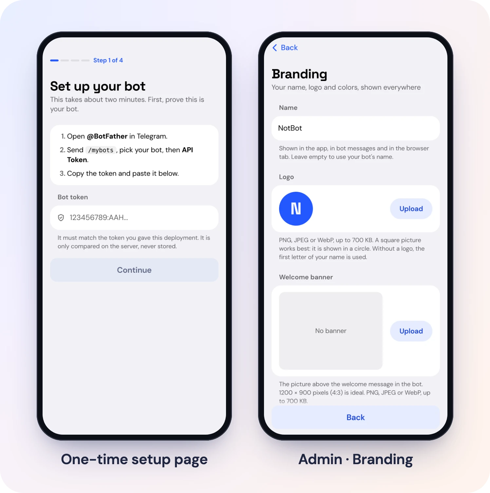
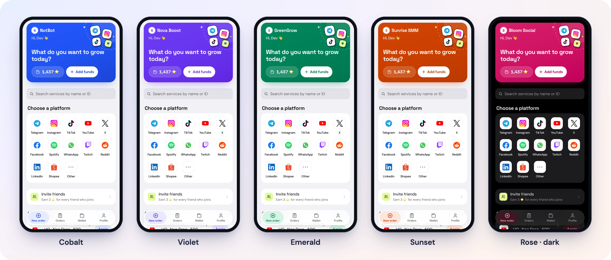

# NotBot: your own SMM shop inside Telegram

NotBot is a Telegram bot and Mini App that sells social media growth services (followers, views, likes and more
for Telegram, Instagram, TikTok, YouTube, X and 30+ platforms). Customers pay with **Telegram Stars**, and every
order is fulfilled automatically by [NotPanel](https://notpanel.com) through your own NotPanel API key. You set the
prices; the markup is your profit.

It runs on **Cloudflare's free plan** and deploys in a few clicks. Name, logo, colors and links are yours to set.

[](https://deploy.workers.cloudflare.com/?url=https://github.com/rehul888/notbot)

<p align="center">
  
</p>

## Features

- **Full shop in a Mini App**: browse platform → category → service, order form with every NotPanel option,
  order tracking, wallet, refunds, order history, referral program.
- **Telegram Stars payments**: top up a balance (presets or any amount) or pay for a single order directly.
- **Automatic catalog and prices**: services, categories and prices sync from NotPanel on a schedule. New services
  can go on sale automatically; services NotPanel removes or pauses are taken off sale.
- **Your pricing**: default markup, per platform, per category or per service, or a fixed price per service.
- **Live order updates**: instant NotPanel webhooks plus a once-a-minute check. The bot messages customers when an
  order finishes, and refunds undelivered parts automatically.
- **White-label branding**: your name, logo, welcome banner, 10 color themes or any custom color, website and terms
  links, custom welcome text, optional Telegram Premium custom emojis in bot messages.
- **20 languages** for customers (English, Español, Português, Русский, Türkçe, العربية, हिन्दी, Indonesia, Français,
  中文, Deutsch, Italiano, Polski, Українська, 日本語, 한국어, Tiếng Việt, فارسی, اردو, বাংলা).
- **Admin panel inside Telegram**: sales and profit, orders, users and balances, payments and Stars refunds,
  referrals, price changes, branding, admins and settings.
- **Optional update channel gate**: require customers to join your channel before ordering.

<p align="center">
  
  
</p>

## What you need

1. A **Telegram bot**: open [@BotFather](https://t.me/BotFather), send `/newbot`, and copy the token.
2. A **NotPanel account and API key**: sign up on [notpanel.com](https://notpanel.com) and create an API key on the
   [developers page](https://notpanel.com/developers). Add funds there: your orders are paid from that balance.
3. A free **Cloudflare** account and a **GitHub** account.

## Deploy in one click

> [!IMPORTANT]
> Use the **Deploy to Cloudflare** button. Don't download the files and upload them in the Cloudflare dashboard
> ("Upload and deploy" / drag and drop): that screen can't build this app and shows a warning about a build process.
> The button builds it for you, on a phone too.

[](https://deploy.workers.cloudflare.com/?url=https://github.com/rehul888/notbot)

1. Click **Deploy to Cloudflare** and sign in (connect your GitHub account when Cloudflare asks).
2. Cloudflare copies this project to your GitHub, creates the database and asks for:
   - `BOT_TOKEN`: your bot token from @BotFather.
   - `NOTPANEL_API_KEY`: your NotPanel API key (starts with `np_live_`).
   - `OWNER_IDS` (optional): your Telegram user ID, if you want to be admin straight away. Leave it empty to claim
     admin in the next step instead.
3. When the deploy finishes, open your app's address (for example `https://notbot.<you>.workers.dev`).
4. The setup page asks for your bot token once (to prove the bot is yours), checks your NotPanel key, and sets up
   everything in Telegram for you: webhook, the **Open App** button, commands, and the bot's name and description
   in all languages.
5. Tap **Claim admin**. Telegram opens your bot with a one-time code, and you're the admin.
6. Open your bot, tap **Open App**, then **Profile → Admin** to set your markup, branding and links. The first
   catalog sync takes about 20 minutes.

That's it. Telegram Stars payments need no extra setup.

<p align="center">
  
</p>

> **Note:** a few profile options can only be set in @BotFather (the bot's profile photo, and making the Mini App the
> bot's "main app"). They're optional.

### Deploying your own copy of the repository instead

If you copied this repository into your GitHub and connect it in Cloudflare (**Workers & Pages → Create → Import a
repository**), fill in the form like this:

| Field | Value |
|---|---|
| Git repository | Your copy. If it says **Missing git connection**, open the repository menu and connect your GitHub account, then allow Cloudflare to access that repository. |
| Build command | `npm run build` |
| Deploy command | `npm run deploy` (or `npx wrangler deploy`) |

Unless you add them under **Advanced settings**, this way doesn't ask for the secrets: after the first deploy, open
your Worker → **Settings → Variables and Secrets** and add `BOT_TOKEN` and `NOTPANEL_API_KEY` as secrets, then open
your app's address to finish setup. The database is
created on the first deploy and the app sets up its own tables.

### Troubleshooting

| You see | Do this |
|---|---|
| "This uploader does not yet support projects that require a build process" | You're on the dashboard's upload screen. Go back and use the **Deploy to Cloudflare** button instead. |
| "Missing git connection" | Cloudflare can't see your GitHub repository yet: connect your GitHub account in that screen and give Cloudflare access to the repository. |
| The build or deploy fails | Open your Worker in the Cloudflare dashboard → **Deployments** → the failed build's log. Check that the build command is `npm run build` and the deploy command is `npm run deploy`, then click **Retry**. |
| The setup page says the bot token doesn't match | Paste the same token you entered during deploy. To change it: Worker → **Settings → Variables and Secrets** → `BOT_TOKEN`. |
| "This isn't a NotPanel API key" | Only NotPanel keys work (they start with `np_live_`). Create one on [notpanel.com/developers](https://notpanel.com/developers). |
| The bot doesn't answer | Open your app's address once more and finish the setup page; every step must show a check mark. |

## Customize

Everything is in the admin panel (Telegram → your bot → Open App → Profile → Admin). Pick a ready-made color theme
or any color you like; the whole app, light and dark, follows it:

<p align="center">
  
</p>

| Where | What |
|---|---|
| Branding | Name, logo, welcome banner, color theme (10 presets or any color), website, terms link, welcome text, Premium custom emojis and button icons. "Update bot name & description in Telegram" applies the new name to the bot's profile. |
| Services & prices | Markup per platform / category / service, fixed prices, show or hide anything. |
| Settings | Stars per $1, top-up limits, price sync, NotPanel low-balance alert, support username, update channel, referral reward and daily cap, terms text, NotPanel API key, admins. |

## How money works

- Money is kept in **US dollars** (NotPanel bills in dollars). Customers only ever see **whole Stars**: prices are
  rounded up, balances rounded down.
- A Stars payment credits its dollar value: at the default 77 Stars per $1, 1 ⭐ ≈ $0.013. Telegram pays out about
  $0.013 per Star, so 77 is roughly break-even and your markup is the profit. You can change the rate in Settings.
- Withdraw Stars as Telegram allows (Fragment), and keep your NotPanel balance topped up.

## Update your copy

Your copy lives in your own GitHub repository. To get a new version, pull this repository into yours and push;
Cloudflare redeploys automatically and applies database updates:

```bash
git remote add upstream https://github.com/rehul888/notbot.git   # once
git pull upstream main
git push
```

## Develop locally

```bash
npm install
cp .dev.vars.example .dev.vars   # add your keys; add DEV_FAKE_USER_ID=1 and OWNER_IDS=1 to open it in a browser
npm run db:migrate:local
npm run dev                      # http://localhost:5173
```

Local development never places real NotPanel orders unless `ALLOW_LIVE_ORDERS=1` is set in `.dev.vars`.
Checks: `npm run typecheck && npm test && npm run build`.

Manual deploy without the button: `npx wrangler login`, then `npm run deploy` (it creates the database), then
`npx wrangler secret put BOT_TOKEN` and `npx wrangler secret put NOTPANEL_API_KEY`, and open your app's address to
finish setup. The app creates and updates its database tables by itself.

## Project layout

| Path | What |
|---|---|
| `src/` | Mini App (Preact + Vite): screens, admin panel, setup page, translations. |
| `worker/` | Cloudflare Worker (Hono): app API, setup, bot webhook, NotPanel webhook, cron jobs. |
| `shared/` | Code shared by both sides: types, money conversion, branding and themes. |
| `migrations/` | D1 database schema. |

## License

NotBot is **source-available** under the [NotBot License (NotPanel-only)](LICENSE): free to use, modify, deploy and
run commercially, **only with the NotPanel API**. It is not an OSI open source license. The app checks every API key
with NotPanel before using it.

Security issues: see [SECURITY.md](SECURITY.md).
